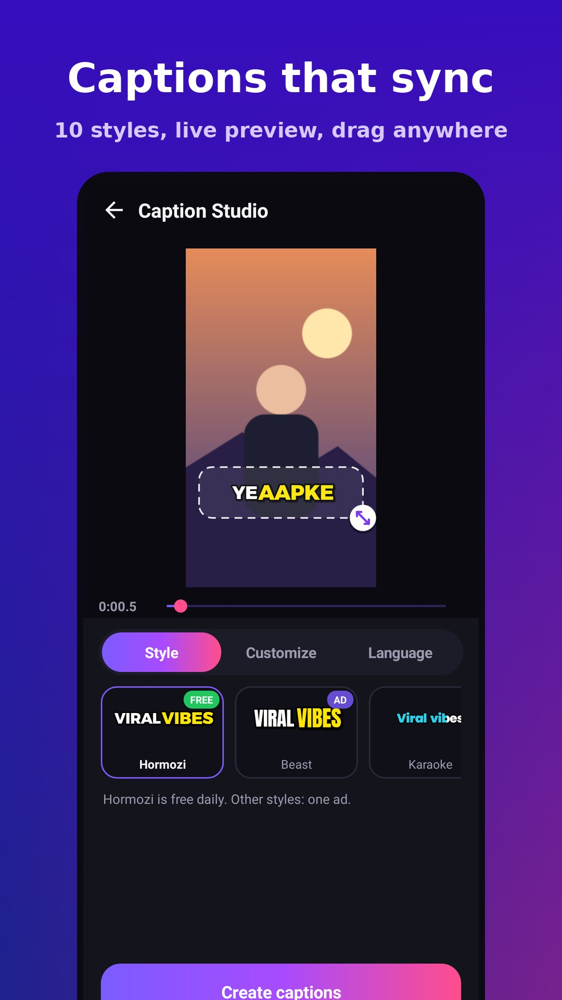
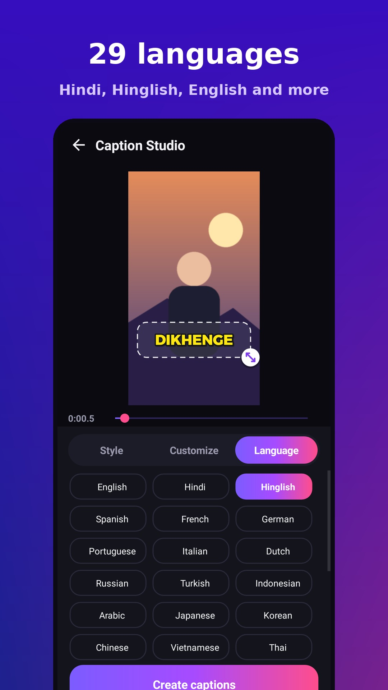
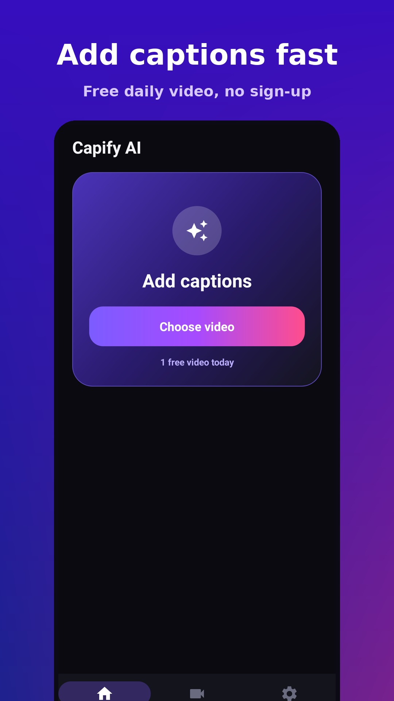

# Capify AI - Auto Captions for Videos

Free Android app that adds clean, word-synced captions to your videos and saves the result to your gallery.

  

## Features
- 10 caption styles, with a live preview where you drag and resize the caption
- 29 languages, including Hindi, Hinglish and English
- Word-by-word highlighting, ALL CAPS, key-word highlight, progress bar
- Export in the original video quality, saved straight to your gallery
- Captions are made on your phone; your video is not uploaded

## Price
Capify AI is free to download and use. On Android you get one free video per day (Hormozi style); other styles and extra videos unlock by watching a short ad. The first time you use a language it downloads a speech model once (about 45-375 MB), so use Wi-Fi.

The Windows version has all features free, with no ads and no account. Its speech model downloads once on first use (about 490 MB; Hindi and Hinglish use a 45 MB one).

## Download
- **Android:** get the APK from the [latest release](../../releases/latest). Android 7.0 or newer.
- **Windows (free, no ads):** from the [latest release](../../releases/latest):
  - `Capify_AI_Windows_Setup.exe` - 64-bit installer
  - `Capify_AI_Windows_32bit_Setup.exe` - 32-bit installer
  - `Capify_AI_Windows_Portable.zip` - 64-bit, unzip and run `Capify AI.exe`, no install

## Support
Email: team.simplefy@gmail.com

Made by SimpleFy.
